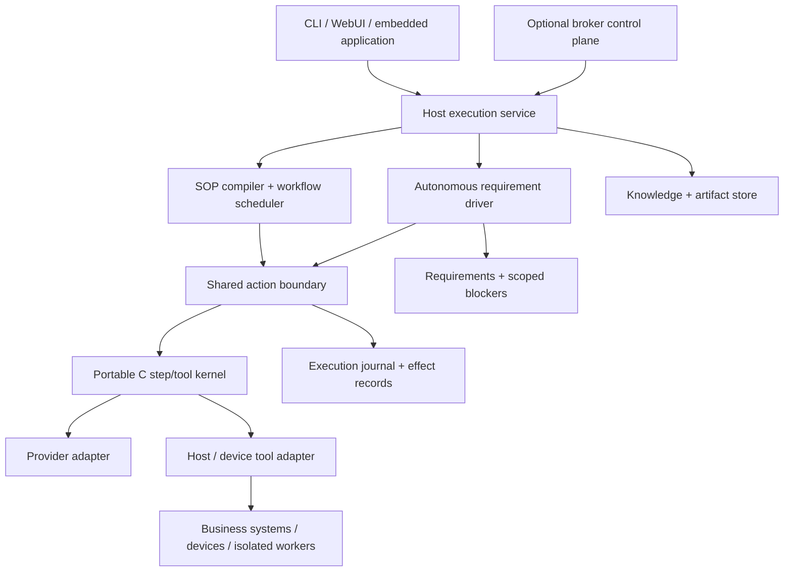

# Agent-C architecture: embedded execution, SOP workflows, and autonomy

Decision date: 2026-11-10. This is the current architectural direction. [Current snapshot](CURRENT_SNAPSHOT.md) distinguishes implemented behavior from the design backlog. [Research and primary sources](research/agent-systems-20261110.md) document the upstream basis. Older design/spec documents remain useful descriptions of their individual subsystems; this document takes precedence on product direction.

## Product contract

Agent-C is a portable execution kernel with host services, a control plane, and replaceable clients. Its three deployment profiles share execution concepts while retaining different resource and persistence implementations:

| Profile | Runs where | Owns |
| --- | --- | --- |
| Embedded core | MCU/RTOS or an application embedding C | Bounded agent steps, local tool execution, cancellation, wire encoding, device-local enforcement |
| Process automation | Edge gateway or server | Versioned SOPs, durable actions, scheduling, business-system/device adapters, operational evidence |
| Autonomous agent | Host service or broker-coordinated deployment | Goal/requirement progress, bounded reasoning, recovery, scoped human dependencies, verification and continuation |

The default operating contract is **autonomous execution of authorized work without permission prompts**. Routine implementation choices and recoverable faults belong to the agent. Explicitly configured access controls, resource limits, stops, and SOP-required human decisions remain effective. A business approval is an explicit process action, not a generic prompt added to every action.

A human-action blocker is a durable fact about an external prerequisite, with observed recovery attempts, a precise requested action, and affected requirements. It is independent of the global run status. Continue unrelated runnable work; suspend the whole execution only when no eligible work remains, the owner stops it, or an explicit limit is reached. On feedback, verify the prerequisite and reconcile every matching blocker, then resume newly eligible work.

## Findings from the source

| Area | Verified existing implementation | Remaining architectural gap |
| --- | --- | --- |
| C kernel | `core/include/agent/tool_loop.h`, `core/src/agent_tool_loop.c`: real tool loop, hooks, compaction, budgets and cancellation. `agent_alloc.c` routes allocations through a process-global allocator. | Provider/tool callbacks are synchronous; allocator isolation and persistent in-flight turn state are absent. Small-footprint claims need measured target profiles. |
| Embedded protocols | Core CBOR/authentication/UM-EAIS support, ESP32 example and host simulator are already present. | Hardware proof, flash wear and power-loss behavior are separate from host tests. Existing maturity docs are historical assessments. |
| Workflow engine | `daemon/src/workflow_engine.h` explicitly documents single-daemon DB ownership and at-least-once task recovery. Submit dedupe, retries, budgets, dataflow and deterministic checks are implemented. | A retried task may repeat an external effect. No general saga/compensation or durable arbitrary human-signal state machine is established by these features. |
| SOP authoring | This snapshot compiles versioned stages/actions into the existing DAG, with a definition digest and stage mapping. | Registry-enforced immutable versions, arbitrary transitions, subflows, signal waits and compensation remain future work. A source digest identifies content; it does not enforce registry immutability. |
| Autonomy | Broker loop already claims ownership, allocates roles, emits drift/progress, and handles replanning. New host work ledger tracks requirements and blockers; completion guard rejects premature stops with runnable work. | `broker/cmd/agentd-orchestrator/orchestrator_run_cycle.go` still maps team success to done; the new host ledger is not yet the broker's canonical goal store. Drift timeout is not semantic correctness. |
| Memory | Existing structured memory, progressive retrieval, recaps and correlation support durable knowledge. | Memory summaries and evidence hashes do not replace execution journals or independent outcome verification. |
| UI/CLI | Existing clients have broad operational coverage, OpenAPI types and replay surfaces. This snapshot modernizes navigation/layout and separates new CLI command handling. | Full goal/blocker UI, granular timeline debugging, and a completely decomposed legacy CLI are not yet implemented. |

The valuable foundation is already here. Keep the C kernel and native hosts, consolidate semantics, and add missing guarantees incrementally. Avoid another parallel orchestration engine or a framework-wide rewrite based on feature checklists.

## Execution model and ownership

The diagram is a target architecture, not a claim that the shared action journal already exists. Today the scheduler, kernel, host tools, and new requirement ledger provide different parts of it.

Use distinct identities: goal, requirement, workflow, stage, action, attempt, effect, artifact, and trace. An attempt is retryable execution of an action; its effect ID remains stable across attempts. Pin workflow source hash, compiler version, tool/schema versions, policy version, and provider configuration in the eventual execution manifest. Keep secrets as references outside the manifest.

Host `agentd` remains the execution authority for its local DB. Broker coordinates deployments and relays control; it must not independently advance the same action. Replace owner-string-only failover with monotonic fencing at the effect boundary before claiming distributed exactly-once ownership. A lease expiration alone cannot stop a stale worker from writing to an external system.

## Embedded profile

Keep the core free of environment, filesystem, network, thread and mandatory database dependencies. The new completion hook is a storage-independent port: a host can request continuation while the original step/cancellation budgets remain in force. MCU implementations can leave it unset or consult a bounded local requirement table.

Next introduce versioned instance configuration with allocator/context, clock, cancellation/deadline and provider/tool lifecycle ports. Retain source-compatible wrappers for the synchronous API. Add a pollable state machine with `NEED_MODEL`, `NEED_TOOL`, `WAIT_EVENT`, `DONE` and `ERROR` outcomes so network and peripheral operations do not monopolize the RTOS task. Do not serialize pointers or assume a host filesystem in checkpoints.

Offer separate deployment choices: device-local deterministic tools plus remote reasoning; C loop plus a network provider on the device; and gateway-local inference on capable Linux hardware. Local inference remains a provider choice. Put physical interlocks, range/unit validation, command expiry and dedupe on the device/controller. Agent reasoning should schedule bounded operations above deterministic control loops.

Measure linked flash, peak/internal RAM, stack high-water, allocation failure recovery, provider/tool cancellation latency, offline behavior and repeated power-loss recovery on a pinned board/SDK configuration. Set release budgets from those measurements. The current host tests establish C portability and behavior, not MCU timing or hardware qualification.

## SOP profile

Author a typed, versioned JSON SOP; visual editing and optional YAML are authoring adapters. Compile it into an immutable execution representation before scheduling. Stable action IDs preserve references, evidence and migration reasoning. The current `agentd.sop.v1` implements ordered stages with sequential or parallel actions and strict stage barriers, then uses existing policy/task validation and scheduling.

Evolve the representation with explicit action types: deterministic tool, agent, branch, bounded loop, subworkflow, timer, external signal, human business decision, and compensation. Conditions operate on schema-validated outputs through a deterministic expression evaluator, with recorded inputs and results. Persist waits; release workers while waiting. Validate graph references, bounds, tool capabilities and forbidden unbounded loops before accepting a version.

Office example: intake → document extraction → deterministic policy checks → explicit manager decision if required by that SOP → ERP submission → reconciliation. Industrial example: collect sensor evidence → evaluate quality limits → schedule a device operation with an expiry and fencing token → verify readback → record batch evidence. A model can interpret ambiguous input or propose recovery; deterministic process rules decide whether the next stage may run.

External writes need an effect protocol: persist intent and stable effect ID before dispatch; record the remote receipt; reconcile by ID/readback after a crash. Classify tools as pure, read-only, idempotent write or non-idempotent write. For an unknown non-idempotent outcome, reconcile or raise a scoped human dependency instead of blindly retrying. Compensation is a separately audited business action, not time travel that undoes physical reality.

Continue to describe current task recovery as at-least-once. Budget accounting currently has best-effort scheduler semantics; production-wide strict caps require atomic reservation, settlement and reconciliation across parallel work. Workflow upgrades pin active runs to the old representation until an explicit migration maps state, waits and outstanding effects.

## Autonomous profile

Use requirements as the smallest independently verifiable work units. Each carries intent, dependencies, status and evidence. A blocker carries a reason, attempted recovery, exact human action and a list of affected requirements; an empty list means advisory. `runnable` is derived from unfinished work whose dependencies are done and whose own blockers are resolved. A blocker on A never automatically prevents unrelated B.

The shipped `work_state` host tool and `agent work` command use the same SQLite implementation. Mutations run under `BEGIN IMMEDIATE`, optionally compare a revision, validate the dependency DAG and publish a derived runnable/waiting projection. Done/resolution records require evidence. Evidence is an inspectable assertion supplied by the caller; the ledger does not magically validate an external outcome.

Once a run adopts the ledger through a successful tool call, a proposed final response is checked against current runnable work. The core can continue the same run with its original budgets. Empty ledgers and unrelated previous workspace ledgers are not automatically adopted. Three repeated final responses without a ledger revision change end with a limit error instead of spending indefinitely. When all remaining work needs external input, the run can yield with the blockers preserved. The current ledger does not itself wake a daemon after a later human edit; durable event-driven wakeup and broker integration are next.

Prefer one worker for sequential work. Add specialists only for independent branches with explicit input/output contracts and acceptance evidence. Model judging can supplement deterministic checks; agreement among copies is not independent proof. Treat documents and tool output as data with provenance, not authority to rewrite the goal, policy or credentials.

## Provider, context and CLI direction

Retain a provider-neutral transcript with opaque adapter metadata. API compatibility must include streaming, tool-result correlation, error handling, usage and continuation behavior. The current Chat Completions adapter already has provider-specific reasoning handling, but that is not proof that every current DeepSeek/Codex route works. Add Responses/native adapters behind explicit capability descriptors rather than silently translating away unsupported features.

Split immutable instructions and capability declarations, current goal/state, retrieved knowledge and recent observations. Keep large data as artifact references and fetch bounded slices. Evaluate artifact-backed context exploration inspired by RLMs on host workloads, behind recursion/cost limits. Preserve evidence and constraints during compaction; do not depend on a prose summary to retain pending effects or human dependencies.

CLI `exec`, stdin, `resume`, `sessions`, explicit workspace/session-root selection and model-free work-state commands now share the existing executor. JSONL transcript export remains available. Further split legacy provider/config/run rendering code behind the same service interfaces used by the daemon. Add structured stdout events, interruption-safe step checkpoints and steering as explicit contracts before advertising equivalence with upstream harnesses.

## UI direction

The shipped shell uses a graphite/mint palette, grouped icon navigation, a real connection indicator, session context, a useful empty state, mobile horizontal navigation, keyboard focus and reduced-motion behavior. Advanced panels load on demand. Existing workflow, memory, voice, broker and approval capabilities remain reachable; there are no fabricated activity metrics.

Next make requirements and human dependencies visible beside the run timeline. Separate Overview, SOP Library/Editor, Runs, Knowledge, Devices and Fleet as capabilities grow. Show actual stage state, evidence and affected requirements; keep low-level protocol/config detail in inspectors. A human-action card should explain the needed action while unrelated work continues. Process approvals appear only when configured by the SOP or operator policy.

## Delivery order and acceptance gates

| Priority | Change | Release gate |
| --- | --- | --- |
| Delivered | SOP v1 lowering; requirement/blocker ledger; completion port; CLI entry points; modern UI shell | Local model-stub, DAG/ledger, API and desktop/mobile browser checks; generated contract check and core-only build |
| P0 | Effect IDs, durable intent/receipt records, reconciliation and failure injection | Crash before dispatch/after remote commit/before local receipt produces no blind duplicate write; unknown outcomes remain explicit |
| P0 | Broker-backed goal/requirement/blocker authority and event-driven wakeup | One blocker leaves other requirements runnable; multiple matching blockers reconcile after one verified fix; restart retains waits and owner stops |
| P1 | SOP registry, typed signals/timers/business decisions, compensation | Pinned active versions survive upgrades; duplicate signals/decisions are idempotent; waiting consumes no worker |
| P1 | Instance-scoped/pollable C runtime and embedded checkpoint port | Host compatibility plus board-level RAM/stack/power-loss/cancellation evidence |
| P1 | Provider adapters and structured CLI event/checkpoint contracts | Fixture matrix covers streaming, tools, compaction, cancellation and resumed metadata for each advertised route |
| P2 | Standard host protocol adapters, context experiments and richer visual authoring | Versioned interop fixtures and measured task success/cost/latency against a single-agent baseline |

Use deterministic infrastructure tests plus workload evaluations: office process, simulated device process, and a long autonomous maintenance goal. Track verified completion, duplicate external effects, recovery time, human interventions, token/tool cost, and resource use. Keep live-provider/hardware results separate from local-stub evidence. Update source, contracts, examples and the snapshot document in the same change.
