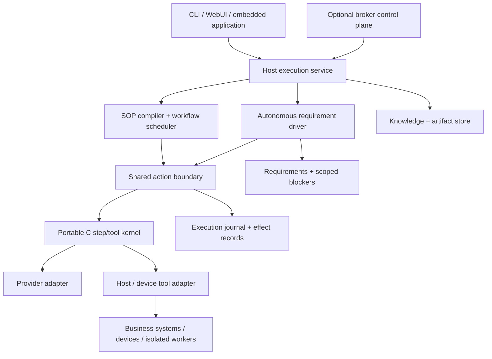

# Agent-C architecture: embedded execution, SOP workflows, and autonomy

Rolling direction updated 2026-11-20; initial decision 2026-11-10. This is the current architectural direction. [Current snapshot](CURRENT_SNAPSHOT.md) distinguishes implemented behavior from the design backlog. [Research and primary sources](research/agent-systems-20261110.md) document the upstream basis. Older design/spec documents remain useful descriptions of their individual subsystems; this document takes precedence on product direction.

This is a rolling project with no compatibility requirement. Prefer coherent refactoring and fresh deployment over migration or compatibility layers. Keep producers, consumers, deployment and verification aligned in one current snapshot. Active process version pinning remains a correctness property within a running deployment; it does not require an upgrade/migration product.

## Product contract

Agent-C is a portable execution kernel with host services, a control plane, and replaceable clients. Its three deployment profiles share execution concepts while retaining different resource and persistence implementations:

| Profile | Runs where | Owns |
| --- | --- | --- |
| Embedded core | MCU/RTOS or an application embedding C | Bounded agent steps, local tool execution, cancellation, wire encoding, device-local enforcement |
| Process automation | Edge gateway or server | Versioned SOPs, durable actions, scheduling, business-system/device adapters, operational evidence |
| Autonomous agent | Host service or broker-coordinated deployment | Goal/requirement progress, bounded reasoning, recovery, scoped human dependencies, verification and continuation |

The default operating contract is **autonomous execution of authorized work without permission prompts**. Routine implementation choices and recoverable faults belong to the agent. Explicitly configured access controls, resource limits, stops, and SOP-required human decisions remain effective. A business approval is an explicit process action, not a generic prompt added to every action.

A human-action blocker is a durable fact about an external prerequisite, with observed recovery attempts, a precise requested action, and affected requirements. It is independent of the global run status. Continue unrelated runnable work; suspend the whole execution only when no eligible work remains, the owner stops it, or an explicit limit is reached. On feedback, verify the prerequisite and reconcile every matching blocker, then resume newly eligible work.

## Findings from the source

| Area | Verified existing implementation | Remaining architectural gap |
| --- | --- | --- |
| C kernel | `core/include/agent/tool_loop.h`, `core/src/agent_tool_loop.c`: real tool loop, hooks, compaction, budgets and cancellation. `agent_alloc.c` routes allocations through a process-global allocator. | Provider/tool callbacks are synchronous; allocator isolation and persistent in-flight turn state are absent. Small-footprint claims need measured target profiles. |
| Embedded protocols | Core CBOR/authentication/UM-EAIS support, ESP32 example and host simulator are already present. | Hardware proof, flash wear and power-loss behavior are separate from host tests. Existing maturity docs are historical assessments. |
| Workflow engine | `daemon/src/workflow_engine.h` explicitly documents single-daemon DB ownership and at-least-once task recovery. Submit dedupe, retries, budgets, dataflow and deterministic checks are implemented. | Deterministic HTTP POSTs now have a journal/receipt boundary; device assignment/outbox publication is atomic; deterministic host actions now retain guarded intent/results, and ordinary model-driven host tasks guard incomplete effects. Ephemeral and session-backed ordinary host-model tasks can replay bounded image preparation and verified provider/tool transcripts after provider failure or restart. Sequential delegated host-model children have distinct parent-owned journals and completed-prefix replay; verified partial checkpoints can traverse cached work with no new tool/step grants while fresh calls remain guarded. Session generations fence stale continuations; final conversation and model receipt commit atomically. Unknown host outcomes and physical device receipt guarantees still require trusted adapters. No general saga/compensation or durable arbitrary human-signal state machine is established. |
| SOP authoring | Versioned stages/actions compile into the existing DAG. The append-only daemon-local registry enforces immutable saved versions; exact references copy verified source into a run snapshot. The composer saves and selects versions without implicit execution. Explicit decision actions persist configured continue/fail choices and release workers while waiting. | Inline SOPs remain ad hoc. Single-delivery JSON signals have exact immutable receipts and opt-in submit-time slots; early input never bypasses dependencies, conditions, expiry-at-activation or owner stops. Bounded per-action conditions compare typed prior results and retain effect-free skip evidence. Arbitrary transitions, subflows, general inbox/broadcast signals, publisher-specific authorization, compensation and active-run migrations remain future work. |
| Autonomy | Explicit bound goals read the existing host requirement/blocker authority, continue independent work, gate completion on recorded evidence and use single-use dispatch/control CAS. Managed requirement waits use bounded server-notified long polling with periodic fallback; immutable broker admission/receipt records recover an original persisted team run after response loss, while owner stops remain authoritative. Unbound goals retain the legacy role/replanning loop. | Durable replayable event streams, multi-authority handoff and reconstruction of unrecorded host outcomes remain open. Evidence presence and drift timeouts are not semantic proof. See [bound goals](GOAL_WORK_LEDGER.md). |
| Memory | Atomic revision-checked publication, compacted consumed-marker receipts, shared current/historical/evidence views, scoped FTS/fallback, hard salience eligibility, original references, revision-checked source retirement and revision-fenced context, registered cache purge, live correlation and input-validated recap originals. | General forget propagation, expiry-intent metadata compaction, durable direct recap admission and generic conclusion/claim validation remain open. Declared eligibility and references are not semantic fact verification or retrieval-quality evidence. |
| UI/CLI | Existing clients have broad operational coverage, OpenAPI types and replay surfaces. This snapshot modernizes navigation/layout and separates new CLI command handling. | Bound-goal authority/progress UI exists; broader goal authoring, granular timeline debugging, and a completely decomposed legacy CLI remain open. |

The valuable foundation is already here. Keep the C kernel and native hosts, consolidate semantics, and add missing guarantees incrementally. Avoid another parallel orchestration engine or a framework-wide rewrite based on feature checklists.

## Execution model and ownership

The diagram is a target architecture. The scheduler, kernel, host tools, requirement ledger and HTTP effect journal provide different parts of it; the journal is not yet a universal action boundary.

Use distinct identities: goal, requirement, workflow, stage, action, attempt, effect, artifact, and trace. An attempt is retryable execution of an action; its effect ID remains stable across attempts. Pin workflow source hash, compiler version, tool/schema versions, policy version, and provider configuration in the eventual execution manifest. Keep secrets as references outside the manifest.

Host `agentd` remains the execution authority for its local DB. Broker coordinates deployments and relays control; it must not independently advance the same action. Replace owner-string-only failover with monotonic fencing at the effect boundary before claiming distributed exactly-once ownership. A lease expiration alone cannot stop a stale worker from writing to an external system.

## Embedded profile

Keep the core free of environment, filesystem, network, thread and mandatory database dependencies. The new completion hook is a storage-independent port: a host can request continuation while the original step/cancellation budgets remain in force. MCU implementations can leave it unset or consult a bounded local requirement table.

Next introduce versioned instance configuration with allocator/context, clock, cancellation/deadline and provider/tool lifecycle ports. Update the core, hosts and examples together around one coherent instance API; avoid compatibility wrappers for this rolling project. Add a pollable state machine with `NEED_MODEL`, `NEED_TOOL`, `WAIT_EVENT`, `DONE` and `ERROR` outcomes so network and peripheral operations do not monopolize the RTOS task. Do not serialize pointers or assume a host filesystem in checkpoints.

Offer separate deployment choices: device-local deterministic tools plus remote reasoning; C loop plus a network provider on the device; and gateway-local inference on capable Linux hardware. Local inference remains a provider choice. Put physical interlocks, range/unit validation, command expiry and dedupe on the device/controller. Agent reasoning should schedule bounded operations above deterministic control loops.

Measure linked flash, peak/internal RAM, stack high-water, allocation failure recovery, provider/tool cancellation latency, offline behavior and repeated power-loss recovery on a pinned board/SDK configuration. Set release budgets from those measurements. The current host tests establish C portability and behavior, not MCU timing or hardware qualification.

## SOP profile

Author a typed, versioned JSON SOP; visual editing and optional YAML are authoring adapters. Compile it into an immutable execution representation before scheduling. Stable action IDs preserve references, evidence and migration reasoning. The current `agentd.sop.v1` implements ordered stages with sequential or parallel actions and strict stage barriers, then uses existing policy/task validation and scheduling.

Current optional `when` actions provide strict Boolean/text/null equality on a successful earlier result, with repeat-aware source references and recorded executed/skipped outcomes. They add no tool permission or general transition engine; see [conditional actions](SOP_WORKFLOWS.md#conditional-actions).

Evolve the representation with explicit action types: deterministic tool, agent, branch, bounded loop, subworkflow, timer, external signal, human business decision, and compensation. Conditions operate on schema-validated outputs through a deterministic expression evaluator, with recorded inputs and results. Persist waits; release workers while waiting. Validate graph references, bounds, tool capabilities and forbidden unbounded loops before accepting a version.

Office example: intake → document extraction → deterministic policy checks → explicit manager decision if required by that SOP → ERP submission → reconciliation. Industrial example: collect sensor evidence → evaluate quality limits → schedule a device operation with an expiry and fencing token → verify readback → record batch evidence. A model can interpret ambiguous input or propose recovery; deterministic process rules decide whether the next stage may run.

External writes need an effect protocol: persist intent and stable effect ID before dispatch; record the remote receipt; reconcile by ID/readback after a crash. Classify tools as pure, read-only, idempotent write or non-idempotent write. For an unknown non-idempotent outcome, reconcile or raise a scoped human dependency instead of blindly retrying. Compensation is a separately audited business action, not time travel that undoes physical reality.

Continue to describe current task recovery as at-least-once. Device rate/resource admission now commits atomically with assignment/outbox identity, and workflow attempt grants/settlement now serialize capacity across workers with conservative crash charges. Provider token/time overages and uninstrumented remote adapter internals remain outside a certified hard resource ceiling; see [WORKFLOW_BUDGETS.md](WORKFLOW_BUDGETS.md). Workflow upgrades pin active runs to the old representation until an explicit migration maps state, waits and outstanding effects.

## Autonomous profile

Use requirements as the smallest independently verifiable work units. Each carries intent, dependencies, status and evidence. A blocker carries a reason, attempted recovery, exact human action and a list of affected requirements; an empty list means advisory. `runnable` is derived from unfinished work whose dependencies are done and whose own blockers are resolved. A blocker on A never automatically prevents unrelated B.

The shipped `work_state` host tool and `agent work` command use the same SQLite implementation. Mutations run under `BEGIN IMMEDIATE`, optionally compare a revision, validate the dependency DAG and publish a derived runnable/waiting projection. Done/resolution records require evidence. Evidence is an inspectable assertion supplied by the caller; the ledger does not magically validate an external outcome.

Once a run adopts the ledger through a successful tool call, a proposed final response is checked against current runnable work. The core can continue the same run with its original budgets. Empty ledgers and unrelated previous workspace ledgers are not automatically adopted. Three repeated final responses without a ledger revision change end with a limit error instead of spending indefinitely. When all remaining work needs external input, the run can yield with the blockers preserved. The ledger signals bounded in-process watchers after commit; external writers are discovered by fallback reads. Explicitly bound broker goals use these advisory wakes plus periodic reconciliation and recover saved original dispatch receipts. A wake still requires fresh owner/authority checks. Durable replayable event streams and multi-authority handoff remain open.

Prefer one worker for sequential work. Add specialists only for independent branches with explicit input/output contracts and acceptance evidence. Model judging can supplement deterministic checks; agreement among copies is not independent proof. Treat documents and tool output as data with provenance, not authority to rewrite the goal, policy or credentials.

## Provider, context and CLI direction

Submission recovery and execution continuation are separate contracts. The
browser now saves a scoped trace receipt before chat dispatch, performs bounded
read-only original-job lookup after response loss, and saves the accepted job
watch before releasing the submission guard. Local acceptance pins and exact-job
retirement outrank delayed preference hints independently of timestamps. Queue
dispatch reads the checked store before React restores a job on reload. It never
retries a POST to infer whether the original ran. Generation-fenced context pages are available in an
optional one-page inspector; they do not establish append-only conversation
identity. See [chat recovery](CHAT_SUBMISSION_FENCE.md) and
[session pages](SESSION_MESSAGE_PAGES.md).

Retain a provider-neutral transcript with opaque adapter metadata. API compatibility must include streaming, tool-result correlation, error handling, usage and continuation behavior. The current Chat Completions adapter already has provider-specific reasoning handling, but that is not proof that every current DeepSeek/Codex route works. Add Responses/native adapters behind explicit capability descriptors rather than silently translating away unsupported features.

Split immutable instructions and capability declarations, current goal/state, retrieved knowledge and recent observations. Keep large data as artifact references and fetch bounded slices. Evaluate artifact-backed context exploration inspired by RLMs on host workloads, behind recursion/cost limits. Preserve evidence and constraints during compaction; do not depend on a prose summary to retain pending effects or human dependencies.

CLI `exec`, stdin, `resume`, `sessions`, explicit workspace/session-root selection and model-free work-state commands now share the existing executor. Versioned JSONL stdout and final-message publication are implemented in a separate output policy module; the older transcript export remains available. Live delivery continues after bounded audit capture fills, and SSE consumers drain coalesced transport batches. Further split legacy provider/config/run rendering code behind the same service interfaces used by the daemon. Ordinary workflow host-model actions now checkpoint bounded provider/tool transcripts at verified frontiers, including persistent sessions with generation fences and atomic conversation/receipt publication; sequential delegated host-model children now inherit those bounded journals and shared-session fences. Direct CLI/chat, other uninstrumented preparation, parallel macro semantics and mid-turn steering remain separate work. Do not advertise universal checkpoint or upstream-harness equivalence.

## Memory authority and retrieval evaluation

**Atomic publication, scoped retrieval and registered cache/recap invalidation are implemented; general forgetting and claim validation remain next.**
[`memory_store.cpp`](../cli/src/memory_store.cpp) now supplies one root-wide OS
writer lock, explicit raw-byte SHA-256 revisions, retained prior originals,
synced atomic replacement and exact historical lookup. `memory_put` requires
`expected_revision`; append tools share the writer. Consolidation captures its
structured base before deriving changes; retention derives from the current
head instead of an old checkpoint. Native workflows preserve revision references,
refuse stale updates without retry and continue independent tasks. Thread/process
contention, real process death, archive failure, malformed blocks and workflow
conflicts are qualified by local synthetic checks. See [the publication
contract](MEMORY.md#revision-checked-publication) for limits and reproduction.
The prior unlocked read/truncate/checkpoint path motivated these tests; it did
not by itself prove a production race. Production remains stopped.

Current/historical/evidence projection is now shared across lexical search,
substring fallback, structured queries, salience and all context modes. Current
state is hard-filtered before BM25/salience; the FTS transaction contains only
that selected scope/view. Content hashes and projection signatures replace
mtime-only refresh. Original refs bind scope/source, raw-byte revision and
byte span or JSON Pointer, with exact reads and final revision-set validation.
Native and API current queries use the authoritative head; checkpoint reads are
explicitly historical. Automatic context drops unversioned recap/assistant hints,
reports incomplete retrieval and includes whole evidence references. Recap
publication checks source revisions after a provider response. See [memory views](MEMORY.md#current-views-and-original-evidence).

Durable marker promotion now publishes consumed-observation receipts with the
fact, binds replacement intents to per-record revisions and reports independent
partial commits. Current consumers revalidate marker derivations against captured
source heads; original references remain historical. Local checks reproduce the
old stale-marker overwrite, then qualify correction preservation, capacity and
process-crash boundaries. This is an implementation reliability result, not a
retrieval-quality measurement. See [the promotion contract](MEMORY.md#durable-marker-promotion).

The current v2 promotion ledger compacts old full decisions into exact consumed
IDs and one-hop original-table references. Up to 4,096 recent full receipts and
32,768 compacted IDs remain authoritative; at most 128 original anchors pin
both the receipt table and its marker revisions. Compaction shares the atomic
fact publication. Missing/corrupt originals hold an intent consumed rather than
making it runnable. New-intent admission is separate from bounded duplicate
scans, and truncated detail is explicit. The real daemon-consolidator fixture
crosses the old 4,096-receipt limit; crash/expiry fixtures preserve original
receipts, leaf evidence and later corrections. This current source format has
no automatic v1 conversion. It reduces current receipt bodies, not total archive
storage; all byte/count bounds still apply. See [compaction and recovery](MEMORY.md#compacted-receipts-and-recovery).

Revision-checked retirement now retains daily/checkpoint originals under the
shared writer lock, validates the removal revision and preserves partial/uncertain
reports through API/UI. Local checks qualify competing writers, real process
death, archive failure and current eligibility after retirement. Active byte/count
limits exclude archives; this is not a hard-forget or total disk-quota result.
See [the retirement contract](MEMORY.md#source-retirement-and-retention).

Source writers now purge registered disposable cache artifacts and sidecars under
a shared cache lease before publication. Indexed queries scrub superseded
scope/view payloads using SQLite core and FTS5 secure deletion. Correlation reads
the current eligible projection directly instead of retaining another copied
payload cache. Exact structured decoding no longer invents metadata or upgrades
unknown schemas during evidence reads.

Saved recaps carry versioned input/evidence manifests. Current list reads validate
the source revision set and eligible evidence; changed or unverifiable outputs
remain explicitly historical. Original assistant text and bounded provider
identity/usage are retained in immutable outcomes; current input provenance never
claims semantic support. Oversized/failed provider results and concurrent input
corrections preserve incomplete receipts without retries. This closes these
specific current consumers, not generic conclusion propagation or direct-call
crash admission. See [cache boundaries](MEMORY.md#snapshot-and-cache-boundaries)
and [recap contract](MEMORY.md#memory-recaps-llm-summaries).

Explicit archive expiry now protects active memory heads and literal revision references under the writer lock, validates bounded inventories and saves metadata intents before unlink. Zero preserves history; ordinary writes no longer silently prune originals. External consumers must preserve their required revisions in active memory. See [expiry policy](MEMORY.md#explicit-archive-expiry).

Next extend cross-system forgetting, expiry-intent metadata compaction, generic
conclusion/claim validators and evidence-preserving handoffs. Invalidation must
never replay external effects. Registered-file removal is not forensic storage
erasure; retained originals still occupy disk. Host retrieval stays outside the
C core. No paid scorer or retrieval-quality promotion is claimed by these source
checks. Keep those remaining authority gates ahead of quality promotion.

The [SAG2 paper v2](https://arxiv.org/html/2610.22588v2) and
[reference implementation](https://github.com/Zleap-AI/SAG-Benchmark/tree/main/sag2)
provide a research lead: lexical candidates are scored against the original
question plus accumulated evidence; terms from selected passages retrieve unseen
passages for rescoring. Retrieval recall and all-evidence success are distinct
from supported final answers. This informs an Agent-C experiment, not an adopted
quality claim. Pin code/corpus/chunks/scorer versions before comparison; the
repository README and paper model pins need reconciliation. The
[optional local-reranker guide](https://github.com/Zleap-AI/SAG-Benchmark/blob/main/sag2/docs/local-rerank.md)
is a later comparison, not a required model installation.

Use the existing lexical index and a pluggable host scorer. TypeSafe/Jev is the
first bounded quality baseline; retain the existing **4B answerer**. No 9B
substitution, KnowLine weight adoption or second expansion is authorized by this
experiment. Verify the current official endpoint, authentication, model revision
and prices before any paid request; an OpenRouter example does not establish
that a direct TypeSafe key works there. Parse only needed dotenv entries as data,
keep credentials out of argv, logs, artifacts and model inputs, and use only
public/synthetic or sanitized fixtures.

The foreground foundation is now implemented in `memory_retrieval.*` and
`typesafe_scorer.*`, exposed by `agent-memory-retrieve`. All research arms share
`question_terms_v1` FTS candidate construction, captured eligibility/chunking and
whole-record context limits. One expansion extracts literal seed terms, retrieves
unseen eligible evidence and rescores it with at most five retained records.
Typed ID/score validation, source fences, explicit fallback and conservative
input-token reservations bound the host path. Prepared/per-arm receipts reuse
the atomic store and refuse an existing output after interruption. Local,
loopback HTTP and actual command fixtures cover failure boundaries. Normal
memory search/context defaults remain lexical; the portable C core is unchanged.
See [the research procedure](MEMORY.md#bounded-evidence-retrieval). Account
canary, held-out evidence metrics and unchanged-4B answer/citation evaluation
remain separate evidence gates; source tests do not promote retrieval quality.
The 2026-11-21 canary stopped at its first authenticated model-discovery GET
with HTTP 451, before any scoring POST. Two direct unauthenticated checks of
`/v1/models` and `/openapi.json` returned the explicit region-unavailable message.
Key validity, account models and scoring quality remain unverified. Supported
provider access is an operation-scoped owner dependency; local reliability,
corpus preparation and other project work continue. No regional bypass, paid
replay, automatic large screen or production restart was attempted.

Public provider capability check on **2026-11-20**: TypeSafe's official
[System One contract](https://docs.typesafe.ai/api/system-one.md) specifies
`POST https://api.typesafe.ai/v1/systemone` with Bearer authentication and
authenticated `GET /v1/models` discovery. Named typed questions return matching
answers, the actual model and input/output usage. Its
[listed price](https://help.typesafe.ai/articles/5187202169-how-much-does-jev-cost)
is **$0.042 per million input tokens**, with output free and prepaid exhaustion
reported as HTTP 402. These public facts do not verify this account's key,
balance or available immutable model revision. No credential discovery,
authenticated canary or paid screening has run for the compaction milestone.
Recheck the contract and price before the bounded canary; record request/response
model identity and budget reservations in that evaluation, not in production.
The [official model table](https://docs.typesafe.ai/models) lists `jev-1.14.0`
and `jev-1.13.0`, each with a 64k per-request and 32k per-question default
context. `jev-latest` currently points to 1.14.0 but moves with releases;
responses identify the version used. The account list may contain aliases
rather than every accepted versioned ID. Discover the account, then verify a
versioned ID in the small canary before freezing it for both cloud arms.
The [error contract](https://docs.typesafe.ai/api/errors) identifies 429 and 529
as backoff candidates; Agent-C still needs its own total attempt/deadline limits
instead of accepting an SDK's default retry loop. Authentication, payment and
schema errors require an explicit incomplete result, not blind replay.

After one separately bounded authentication/scoring canary, freeze 20 held-out
questions and compare A: FTS, B: identical FTS plus Jev reranking, C: identical
scorer/prompt/selection policy plus one expansion. Hold corpus eligibility,
chunking, final context allowance and the 4B answerer constant. Include exact
lookup, two/three-record bridges, superseded/current/history, conflicts,
unanswerable queries, aliases, Chinese/English and code identifiers. Keep tuning
cases separate.

Pilot caps: 20 initial candidates; at most 20 new plus 5 retained expansion
candidates; at most 8 final records; **75 HTTP attempts and 1300 candidate
judgments total for cloud arms**, with the canary bounded separately. Set a
conservative token ceiling and estimated monetary ceiling from current provider
prices before the batch. Validate typed responses, candidate IDs and finite
bounded scores. Enforce a total deadline, cancellation, bounded retry/backoff and
explicit incomplete/budget status with lexical fallback. Stop at the first cap,
retain completed results, and do not replay paid calls or launch a full benchmark
automatically. Preserve seed-ID → term → resulting-source provenance.

Measure evidence recall, complete-evidence success, supported-answer correctness
and citations, stale/scope exposure, scoring inputs/usage/cost, cold/warm time,
p50/p95 with the small-screen caveat, RAM/VRAM and cancellation. Promote only a
useful measured improvement over rerank-only within the operating budget and with
no critical currentness/scope/effect regression. The discovery-only canary above
is not a scoring or pilot result. Foreground research authorization
does not restart production Agent-C workloads.

The independent synthetic 20-case input/label set is now frozen in commit
`c497a7f`, with code/chunker/default-policy identities pinned to `f32f8c2` before
measurement. The implementer authored this initial screen; it is not an
independently adjudicated production benchmark. Local A recovered **26/28**
required records across 16 evidence-bearing cases: **90.625% macro recall** and
**14/16 complete evidence**. Four unanswerable cases are excluded from those
denominators and reported separately. Original references, scope and eligibility
validate with zero observed exposure; missing evidence in `q04` and `q18` remains
recorded without policy/corpus changes. The offline evaluator checks forgeries,
partial/missing arms and exact context byte accounting. A separate free helper
measures cold-index/warm-index queries with identical evidence, leaving OS caches
alone. See [the screen protocol and measurements](MEMORY.md#frozen-20-question-screen-and-offline-metrics).
B/C, actual scorer identity and supported 4B answer/citation evaluation remain
pending. No quality promotion follows from A. The owner requested handoff and
stop after this milestone; independent work resumes only on a new instruction.

## UI direction

The shipped shell uses a graphite/mint palette, grouped icon navigation, a real connection indicator, session context, a useful empty state, mobile horizontal navigation, keyboard focus and reduced-motion behavior. Advanced panels load on demand. Existing workflow, memory, voice, broker and approval capabilities remain reachable; there are no fabricated activity metrics.

Next make requirements and human dependencies visible beside the run timeline. Separate Overview, SOP Library/Editor, Runs, Knowledge, Devices and Fleet as capabilities grow. Show actual stage state, evidence and affected requirements; keep low-level protocol/config detail in inspectors. A human-action card should explain the needed action while unrelated work continues. Process approvals appear only when configured by the SOP or operator policy.

## Delivery order and acceptance gates

| Priority | Change | Release gate |
| --- | --- | --- |
| Delivered | SOP v1 lowering; requirement/blocker ledger; completion port; CLI entry points; modern UI shell | Local model-stub, DAG/ledger, API and desktop/mobile browser checks; generated contract check and core-only build |
| Delivered for HTTP POST, deterministic host tools, remote workflow admission and session-fenced model transcripts; P0 for remaining adapters | Effect IDs, durable intent/receipt records, reconciliation and failure injection | Crash before dispatch/after remote commit/before local receipt produces no blind duplicate write; unknown outcomes remain explicit |
| Delivered for one bound authority with bounded server-notified wakeup; P0 for multi-authority handoff | Host requirement authority, broker control/receipt journal, advisory notifications plus polling fallback | Independent work continues; changed requirements wake before normal polling; stale hints, restart, unavailable watches and owner stops never authorize blind dispatch |
| Delivered registry, decisions, bounded signals and conditional actions; P1 for richer processes | Immutable saved SOP versions, pinned snapshots, worker-free decisions/signals and typed optional actions; opt-in early signal slots; next general inbox/broadcast/identity, general transitions/loops, richer timers, role-bound approvals and compensation | Registry/input integrity, immutable delivery/races, effect-free skip receipts, repeated-source mapping, restart, expiry, stop preservation and independent progress are tested; broader event-bus and transition semantics remain outstanding |
| P1 | Instance-scoped/pollable C runtime and embedded checkpoint port | Host compatibility plus board-level RAM/stack/power-loss/cancellation evidence |
| P1 | Provider adapters and structured CLI event/checkpoint contracts | Fixture matrix covers streaming, tools, compaction, cancellation and resumed metadata for each advertised route |
| P2 | Standard host protocol adapters, context experiments and richer visual authoring | Versioned interop fixtures and measured task success/cost/latency against a single-agent baseline |

Use deterministic infrastructure tests plus workload evaluations: office process, simulated device process, and a long autonomous maintenance goal. Track verified completion, duplicate external effects, recovery time, human interventions, token/tool cost, and resource use. Keep live-provider/hardware results separate from local-stub evidence. Update source, contracts, examples and the snapshot document in the same change.

The shipped HTTP boundary and its exact remote adapter contract are documented in [WORKFLOW_EFFECTS.md](WORKFLOW_EFFECTS.md). A workflow error is now finalized only after independent eligible branches settle.

The device dispatch boundary and its physical-execution limits are documented in [DEVICE_ASSIGNMENTS.md](DEVICE_ASSIGNMENTS.md). Durable assignment identity is separate from the scheduler attempt and the device transport cursor.
